# Product Requirement Document (PRD)

# AsLab — Sistem Informasi Absensi dan Penilaian Praktikum

**Studi Kasus:** Pengelolaan absensi dan nilai praktikum di laboratorium departemen
**Jenis Aplikasi:** Aplikasi Desktop Rich UI
**Mata Kuliah:** Pemrograman Berbasis Kerangka Kerja (PBKK)
**Versi Dokumen:** 1.3
**Tanggal:** 21 Oktober 2026
**Status:** Aplikasi selesai diimplementasi dan lolos 62 tes otomatis (lihat [Bagian 16](#16-status-implementasi))
**Repositori:** https://github.com/mouisbeton/AsLab

| No | Nama | NRP | Peran |
|---|---|---|---|
| 1 | ... | ... | Database, Autentikasi, CRUD Master |
| 2 | ... | ... | Absensi, Penilaian & Rekap Nilai |
| 3 | ... | ... | UI/UX & Dashboard |

> Export laporan dan video demo dikerjakan bersama oleh seluruh anggota. Detail pembagian tugas: lihat [Bagian 13](#13-pembagian-tugas-tim).

---

## 1. Ringkasan Produk

### 1.1 Tujuan Produk

AsLab adalah aplikasi desktop yang menyatukan data praktikan, kelas, modul, absensi, dan nilai praktikum dalam satu sistem. Aplikasi ini membantu asisten praktikum mencatat absensi dan nilai, menghitung nilai akhir secara otomatis dan konsisten, membatasi akses sesuai peran pengguna, serta menampilkan dashboard yang memantau progres praktikum secara real-time.

### 1.2 Pernyataan Produk

> Untuk **koordinator asisten, asisten praktikum, dan dosen pengampu** yang selama ini mengelola absensi dan nilai praktikum di banyak spreadsheet terpisah, **AsLab** adalah **aplikasi desktop Rich UI** yang **menyatukan pencatatan, menghitung nilai otomatis, dan memberi peringatan dini terhadap praktikan berisiko**. Berbeda dengan spreadsheet bersama, AsLab **membatasi akses per peran, mencatat setiap perubahan nilai, dan mengunci nilai setelah difinalisasi**.

---

## 2. Latar Belakang dan Masalah

Di banyak laboratorium, absensi dan nilai praktikum dicatat oleh asisten menggunakan spreadsheet yang terpisah per kelas atau per modul. Cara ini menimbulkan beberapa masalah:

| No | Masalah | Dampak |
|---|---|---|
| P1 | Data tersebar di banyak spreadsheet dengan format berbeda | Koordinator membutuhkan waktu lama untuk merekap nilai akhir |
| P2 | Rumus bobot nilai diketik manual oleh tiap asisten | Rawan salah hitung dan nilai tidak konsisten antar kelas |
| P3 | Semua asisten dapat mengedit seluruh sheet | Nilai dapat berubah tanpa jejak siapa yang mengubah |
| P4 | Kehadiran tidak dipantau secara berkala | Praktikan yang melewati batas ketidakhadiran baru diketahui di akhir semester |
| P5 | Tidak ada ringkasan performa per modul | Dosen tidak mengetahui modul mana yang paling sulit bagi praktikan |

---

## 3. Tujuan, Indikator Keberhasilan, dan Batasan

### 3.1 Tujuan dan Indikator

| No | Tujuan | Indikator Keberhasilan | Menjawab |
|---|---|---|---|
| T1 | Mempercepat rekap nilai | Rekap nilai akhir satu kelas selesai dalam < 1 menit | P1 |
| T2 | Menjamin nilai akurat dan konsisten | 0 selisih antara hasil hitung sistem dan hitung manual pada data uji | P2 |
| T3 | Mengamankan data nilai | Asisten tidak dapat melihat atau mengubah nilai kelas yang tidak ditugaskan kepadanya (lolos uji akses per role) | P3 |
| T4 | Menyediakan jejak perubahan | Setiap perubahan nilai tercatat di log aktivitas (siapa, apa, kapan) | P3 |
| T5 | Mendeteksi praktikan berisiko lebih awal | Praktikan dengan kehadiran < 75% otomatis tampil di dashboard | P4 |
| T6 | Memberi gambaran performa per modul | Dashboard menampilkan grafik rata-rata nilai per modul dari data database | P5 |

### 3.2 Batasan (Di Luar Cakupan)

- Praktikan **tidak** login ke aplikasi; pengguna hanya koordinator, asisten, dan dosen.
- Tidak ada fitur unggah laporan praktikum (ditangani LMS).
- Tidak terintegrasi dengan sistem akademik kampus; data dimasukkan manual atau melalui import CSV.
- Aplikasi berjalan lokal / dalam jaringan lab, bukan aplikasi web atau mobile.

---

## 4. Pengguna dan Hak Akses

| Role | Deskripsi | Hak Akses |
|---|---|---|
| **Koordinator Asisten** (Admin) | Penanggung jawab praktikum | Kelola seluruh data master, atur komponen & bobot nilai, kelola akun, penugasan asisten, finalisasi & kunci nilai, lihat log aktivitas |
| **Asisten Praktikum** | Pengajar di kelas praktikum | Input absensi dan nilai **hanya untuk kelas yang ditugaskan**; dashboard, rekap, dan detail praktikan hanya menampilkan data kelasnya |
| **Dosen Pengampu** | Pemilik mata praktikum | Lihat dashboard dan rekap nilai **mata praktikum yang diampunya**, export laporan (read-only) |

Cakupan data setiap role diatur oleh BR-09 dan BR-11.

---

## 5. User Stories

| ID | Sebagai | Saya ingin | Agar |
|---|---|---|---|
| US-01 | Koordinator | Mengimpor daftar praktikan dari file CSV | Tidak perlu mengetik data satu per satu |
| US-02 | Koordinator | Menugaskan asisten ke kelas tertentu | Setiap asisten hanya mengelola kelasnya sendiri |
| US-03 | Koordinator | Menentukan komponen nilai (misalnya pretest, praktik, laporan, kuis) beserta bobotnya untuk setiap mata praktikum | Perhitungan nilai sesuai aturan praktikum masing-masing |
| US-04 | Asisten | Mencatat absensi praktikan per modul dengan cepat | Kehadiran tercatat rapi setiap sesi |
| US-05 | Asisten | Mengisi nilai dalam tabel seperti spreadsheet | Input nilai cepat dan nilai modul langsung terhitung |
| US-06 | Asisten | Mendapat peringatan jika memasukkan nilai tidak valid | Tidak terjadi salah input |
| US-07 | Koordinator | Melihat daftar praktikan berisiko di dashboard | Dapat menindaklanjuti sebelum akhir semester |
| US-08 | Koordinator | Memfinalisasi dan mengunci nilai | Nilai tidak berubah setelah disetujui |
| US-09 | Dosen | Melihat grafik rata-rata nilai per modul | Mengetahui modul yang perlu dievaluasi |
| US-10 | Dosen | Mengekspor rekap nilai ke Excel/PDF | Dapat diunggah ke sistem akademik |

---

## 6. Kebutuhan Fungsional

**Prioritas:** M = Must have (wajib ETS), S = Should have, C = Could have

| ID | Fitur | Deskripsi | Prioritas |
|---|---|---|---|
| FR-01 | Login & Logout | Autentikasi username/password dengan password ter-hash | M |
| FR-02 | Role-Based Access | Menu dan aksi menyesuaikan role pengguna | M |
| FR-03 | CRUD Praktikan | Tambah, lihat, ubah, hapus data praktikan | M |
| FR-04 | CRUD Mata Praktikum, Kelas, Modul | Kelola struktur praktikum | M |
| FR-05 | Kelola Akun & Penugasan Asisten | Membuat akun asisten/dosen dan memetakan asisten ke kelas | M |
| FR-06 | Input Absensi | Pilih kelas + modul → status Hadir/Izin/Sakit/Alpa, tombol "Tandai semua hadir" | M |
| FR-07 | Input Nilai | Tabel editable dengan satu kolom per komponen nilai mata praktikum; nilai modul dihitung otomatis | M |
| FR-08 | Rekap Nilai Akhir | Nilai akhir, nilai huruf, persentase kehadiran, status kelulusan per praktikan | M |
| FR-09 | Pencarian & Filter | Cari NRP/nama; filter kelas, angkatan, status | M |
| FR-10 | Dashboard | Kartu statistik, grafik, praktikan berisiko, aktivitas terbaru | M |
| FR-11 | Validasi Input | Pesan error jelas untuk input tidak valid | M |
| FR-12 | Import CSV | Impor data praktikan dari CSV sesuai format di Bagian 6.1 | S |
| FR-13 | Export Excel/PDF | Ekspor rekap nilai per kelas | S |
| FR-14 | Finalisasi, Kunci & Buka Kunci | Koordinator mengunci absensi dan nilai per kelas, dan dapat membuka kunci kembali; asisten tidak dapat mengubah data kelas yang terkunci (BR-10) | S |
| FR-15 | Log Aktivitas | Mencatat **setiap perubahan nilai** (wajib, untuk T4) serta perubahan data penting lainnya: siapa, apa, kapan | M |
| FR-16 | Detail Praktikan | Profil praktikan + grafik progres nilai per modul | C |
| FR-17 | Tema Gelap/Terang | Pengguna dapat mengganti tema | C |
| FR-18 | Backup Database | Membuat file backup SQL Server (.bak) secara manual dengan BACKUP DATABASE; dipulihkan lewat SSMS | C |
| FR-19 | Pengaturan Komponen Nilai | Koordinator menambah, menghapus, mengganti nama, dan mengatur bobot komponen nilai per mata praktikum (total 100); nilai modul dihitung ulang sesuai BR-13 | S |

### 6.1 Format Import CSV

- File UTF-8, pemisah koma, baris pertama berisi header.
- Kolom: `nrp,nama,angkatan,email,nama_kelas`. Kolom `nama_kelas` boleh kosong; bila diisi, praktikan langsung didaftarkan ke kelas tersebut pada mata praktikum yang dipilih saat import.
- Baris valid diimpor dan baris tidak valid dilewati. Contoh baris tidak valid: NRP bukan 10 digit, NRP sudah terdaftar, kelas tidak ditemukan, atau praktikan sudah terdaftar di kelas lain pada mata praktikum yang sama (BR-14).
- Setelah import, aplikasi menampilkan ringkasan: jumlah baris berhasil, jumlah baris gagal, serta nomor baris dan alasan setiap kegagalan.

---

## 7. Aturan Bisnis

| ID | Aturan |
|---|---|
| BR-01 | **Nilai Modul** = Σ (skor komponen × bobot komponen) ÷ 100. Setiap mata praktikum memiliki **daftar komponen nilai sendiri** (nama + bobot dalam persen), minimal satu komponen, nama tidak boleh kembar, setiap bobot > 0, dan total bobot harus tepat **100**. Mata praktikum baru otomatis memakai komponen bawaan Pretest 20, Praktik 50, Laporan 30. |
| BR-02 | **Nilai Akhir** = rata-rata nilai modul dari **seluruh** modul pada mata praktikum. Modul yang tidak memiliki nilai untuk seorang praktikan (misalnya karena Alpa) dihitung **0**. **Nilai sementara** = rata-rata nilai modul dari modul yang sudah dinilai di kelas praktikan (minimal satu praktikan di kelas itu sudah memiliki nilai pada modul tersebut); praktikan tanpa nilai pada modul itu dihitung 0. |
| BR-03 | **Persentase Kehadiran** = jumlah Hadir ÷ (jumlah Hadir + jumlah Alpa) × 100%, dihitung dari modul yang absensinya sudah dicatat. Izin dan Sakit **dikeluarkan dari perhitungan**, sehingga tidak menaikkan maupun menurunkan kehadiran. Jika praktikan belum memiliki status Hadir/Alpa sama sekali, kehadiran ditampilkan "–" dan tidak dianggap berisiko. (Batas maksimal Izin/Sakit, bila ada, dapat ditambahkan sesuai aturan laboratorium.) |
| BR-04 | **Status kelulusan** ditetapkan setelah seluruh modul selesai: **Tidak Memenuhi Syarat** bila kehadiran < 75%, terlepas dari nilainya; **Lulus** bila kehadiran ≥ 75% dan nilai akhir ≥ 56 (huruf C atau lebih baik); **Tidak Lulus** bila kehadiran ≥ 75% dan nilai akhir < 56. Selama praktikum masih berjalan, status ditampilkan **"Berjalan"**. |
| BR-05 | Praktikan **berisiko** = kehadiran < 75% **atau** nilai sementara < 56. |
| BR-06 | **Konversi nilai huruf** (batas bawah termasuk, batas atas tidak termasuk): A: n ≥ 86; AB: 76 ≤ n < 86; B: 66 ≤ n < 76; BC: 61 ≤ n < 66; C: 56 ≤ n < 61; D: 41 ≤ n < 56; E: n < 41 (dapat disesuaikan dengan aturan departemen). |
| BR-07 | Skor setiap komponen harus berupa angka **0–100** dengan maksimal 2 angka desimal, dan semua komponen wajib diisi bila salah satunya diisi. |
| BR-08 | NRP harus **unik** dan terdiri dari **10 digit angka**. |
| BR-09 | Asisten hanya dapat **membuka dan mengubah** absensi dan nilai kelas yang ditugaskan kepadanya. |
| BR-10 | **Finalisasi berlaku per kelas.** Setelah kelas dikunci, absensi **dan** nilai seluruh praktikan di kelas tersebut tidak dapat diubah oleh siapa pun sampai koordinator membuka kunci. Aksi kunci dan buka kunci dicatat di log aktivitas. |
| BR-11 | **Cakupan data per role** berlaku di semua halaman, termasuk Dashboard, Rekap Nilai, Detail Praktikan, dan export: Koordinator melihat seluruh data; Asisten hanya data kelas yang ditugaskan kepadanya; Dosen hanya data mata praktikum yang diampunya (`mata_praktikum.dosen_id`). |
| BR-12 | **Pembulatan:** nilai modul dan nilai akhir dibulatkan ke **2 desimal** (half up) saat disimpan dan ditampilkan. Nilai akhir dihitung dari nilai modul yang sudah dibulatkan. Konversi huruf dan status memakai nilai akhir yang sudah dibulatkan. Persentase kehadiran ditampilkan dengan 2 desimal. |
| BR-13 | **Perubahan komponen nilai** hanya diizinkan selama belum ada kelas pada mata praktikum tersebut yang dikunci. Setelah ada nilai yang diinput, komponen **tidak dapat ditambah atau dihapus** (agar nilai lama tidak menjadi tidak lengkap); nama dan bobotnya tetap dapat diubah. Setiap perubahan menghitung ulang `nilai_modul` seluruh praktikan pada mata praktikum itu dan dicatat di log aktivitas. |
| BR-14 | Seorang praktikan hanya boleh terdaftar di **satu kelas** per mata praktikum (dicek aplikasi saat menambah peserta dan saat import CSV). |

---

## 8. Kebutuhan Non-Fungsional

| ID | Kategori | Kebutuhan |
|---|---|---|
| NFR-01 | Keamanan | Password disimpan dalam bentuk hash; seluruh query menggunakan parameterized query |
| NFR-02 | Performa | Pencarian dan filter pada 500 data praktikan tampil < 1 detik |
| NFR-03 | Usability | Setiap aksi hapus meminta konfirmasi; pesan error menjelaskan cara memperbaiki |
| NFR-04 | Konsistensi UI | Warna, font, dan komponen seragam di seluruh halaman |
| NFR-05 | Keandalan | Data tidak hilang saat aplikasi ditutup tiba-tiba (transaksi database) |
| NFR-06 | Portabilitas | Berjalan di Windows 10/11 tanpa konfigurasi rumit |

---

## 9. Rancangan Data

### 9.1 Entity Relationship Diagram

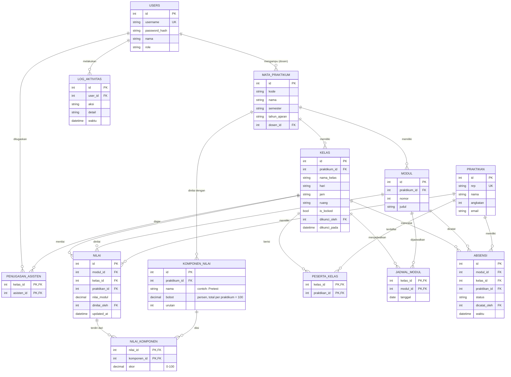

Versi gambar ERD (dirender dari kode Mermaid di atas, sumber: `docs/diagram/erd.mmd`):

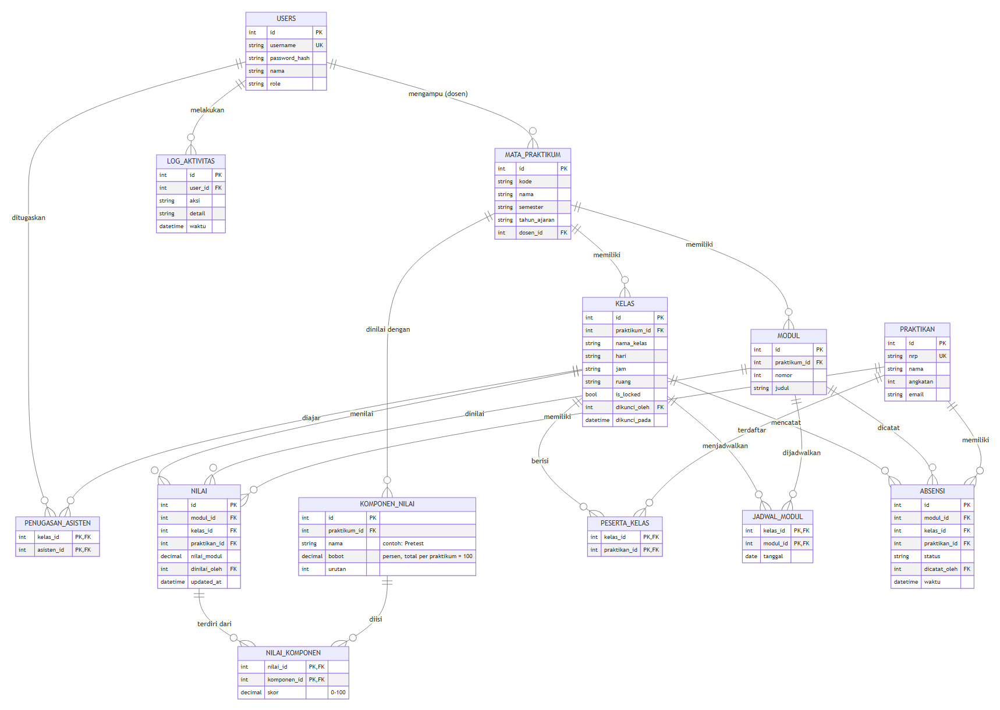

### 9.2 Kamus Data Singkat

| Tabel | Keterangan |
|---|---|
| `users` | Akun pengguna; `role` ∈ {koordinator, asisten, dosen} |
| `mata_praktikum` | Praktikum per semester |
| `komponen_nilai` | Komponen penilaian setiap mata praktikum (nama, bobot dalam persen, urutan kolom) |
| `kelas` | Kelas/sesi praktikum dari suatu mata praktikum, beserta status kunci finalisasi (BR-10) |
| `modul` | Modul/pertemuan praktikum (sama untuk semua kelas) |
| `jadwal_modul` | Tanggal pelaksanaan setiap modul di setiap kelas, karena tiap kelas bertemu di hari berbeda |
| `praktikan` | Data mahasiswa peserta praktikum |
| `peserta_kelas` | Relasi praktikan ↔ kelas |
| `penugasan_asisten` | Relasi asisten ↔ kelas |
| `absensi` | Kehadiran per praktikan per modul; `status` ∈ {Hadir, Izin, Sakit, Alpa} |
| `nilai` | Nilai modul per praktikan per modul (hasil hitung dari skor komponennya) |
| `nilai_komponen` | Skor setiap komponen untuk satu baris `nilai` |
| `log_aktivitas` | Jejak perubahan data penting |

### 9.3 Constraint Database

| Tabel | Constraint |
|---|---|
| `users` | `username` UNIQUE; `role` CHECK ∈ {koordinator, asisten, dosen} |
| `komponen_nilai` | UNIQUE (`praktikum_id`, `nama`); CHECK `bobot > 0 AND bobot <= 100`; total bobot per mata praktikum = 100 (dicek aplikasi karena melibatkan beberapa baris) |
| `modul` | UNIQUE (`praktikum_id`, `nomor`) |
| `jadwal_modul` | PRIMARY KEY (`kelas_id`, `modul_id`) |
| `praktikan` | `nrp` UNIQUE, 10 digit angka (BR-08) |
| `peserta_kelas` | PRIMARY KEY (`kelas_id`, `praktikan_id`); satu praktikan maksimal satu kelas per mata praktikum (BR-14, dicek aplikasi) |
| `penugasan_asisten` | PRIMARY KEY (`kelas_id`, `asisten_id`); `asisten_id` harus user dengan role asisten |
| `absensi` | UNIQUE (`modul_id`, `praktikan_id`); `status` CHECK ∈ {Hadir, Izin, Sakit, Alpa} |
| `nilai` | UNIQUE (`modul_id`, `praktikan_id`) |
| `nilai_komponen` | PRIMARY KEY (`nilai_id`, `komponen_id`); `skor` CHECK 0–100 |

---

## 10. Rancangan Antarmuka (Rich UI)

Navigasi menggunakan **sidebar** di sisi kiri; menu yang tampil menyesuaikan role pengguna.

| Halaman | Komponen Utama | Role |
|---|---|---|
| **Login** | Form login, validasi, pesan error | Semua |
| **Dashboard** | 4 kartu statistik (Total Praktikan, Kelas Aktif, Modul Berjalan, Rata-rata Kehadiran); grafik batang rata-rata nilai per modul; grafik donat distribusi nilai huruf; tabel praktikan berisiko; aktivitas terbaru | Semua |
| **Data Praktikan** | Tabel + pencarian + filter + paging; tombol Tambah/Edit/Hapus; Import CSV | Koordinator |
| **Kelas & Modul** | Tampilan master–detail: pilih kelas → daftar peserta, asisten, modul, dan jadwal tanggal modul di kelas tersebut | Koordinator |
| **Asisten & Akun** | Daftar akun, form akun, penugasan asisten ke kelas | Koordinator |
| **Absensi** | Dropdown kelas & modul; tabel status dengan badge berwarna; "Tandai semua hadir"; read-only dengan ikon gembok bila kelas dikunci | Koordinator, Asisten |
| **Input Nilai** | Tabel editable; nilai modul terhitung otomatis; sel tidak valid diberi tanda merah; read-only dengan ikon gembok bila kelas dikunci | Koordinator, Asisten |
| **Rekap Nilai** | Tabel nilai akhir, nilai huruf, kehadiran, status; Export Excel/PDF; tombol Finalisasi / Buka Kunci per kelas | Semua (Finalisasi & Buka Kunci: Koordinator) |
| **Detail Praktikan** | Profil + grafik garis progres nilai per modul + riwayat absensi | Semua |
| **Pengaturan** | Komponen nilai (nama & bobot per mata praktikum), backup database, log aktivitas (tema gelap/terang diganti lewat tombol di header oleh semua pengguna) | Koordinator |

Kolom **Role** menunjukkan siapa yang dapat membuka halaman. Data yang tampil di dalamnya tetap dibatasi oleh BR-11, misalnya Dashboard milik asisten hanya menghitung kelas yang ditugaskan kepadanya. Kartu **Modul Berjalan** = jumlah modul yang tanggalnya di `jadwal_modul` ≤ hari ini pada minimal satu kelas dalam cakupan pengguna ÷ total modul.

### 10.1 Sketsa Dashboard

```
┌─────────────┬──────────────────────────────────────────────────────────┐
│  AsLab      │  Dashboard                          🔍  ☀/🌙  Koordinator │
│             ├──────────────┬──────────────┬──────────────┬─────────────┤
│ ▣ Dashboard │ Praktikan    │ Kelas Aktif  │ Modul        │ Kehadiran   │
│ ▢ Praktikan │    120       │     6        │   5 / 8      │   88.4%     │
│ ▢ Kelas     ├──────────────┴──────────────┼──────────────┴─────────────┤
│ ▢ Asisten   │ Rata-rata Nilai per Modul   │ Distribusi Nilai Huruf     │
│ ▢ Absensi   │ ▇ ▆ ▇ ▅ ▃                   │        ◕ A  AB  B ...      │
│ ▢ Nilai     │ M1 M2 M3 M4 M5              │                            │
│ ▢ Rekap     ├─────────────────────────────┼────────────────────────────┤
│ ▢ Pengaturan│ ⚠ Praktikan Berisiko        │ Aktivitas Terbaru          │
│             │ 50252410xx  Hadir 62%       │ Asisten X input nilai M5   │
│ ⏻ Logout    │ 50252410xx  Nilai 48        │ Koordinator kunci Kelas A  │
└─────────────┴─────────────────────────────┴────────────────────────────┘
```

### 10.2 Tampilan Aplikasi (Hasil Implementasi)

Seluruh gambar diambil dari aplikasi yang berjalan dengan data contoh (folder `docs/screenshots/`).

| No | Halaman | Yang ditunjukkan | Gambar |
|---|---|---|---|
| 1 | Login | Form login (FR-01) | 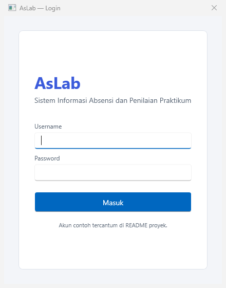 |
| 2 | Login gagal | Pesan error saat password salah (TC-01) | 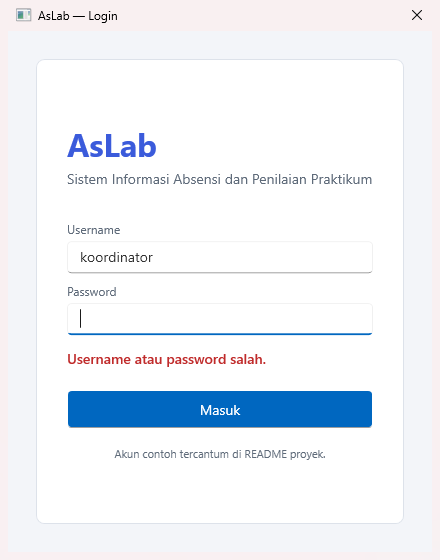 |
| 3 | Dashboard | 4 kartu statistik, grafik nilai per modul, distribusi huruf, praktikan berisiko, aktivitas terbaru (FR-10) | 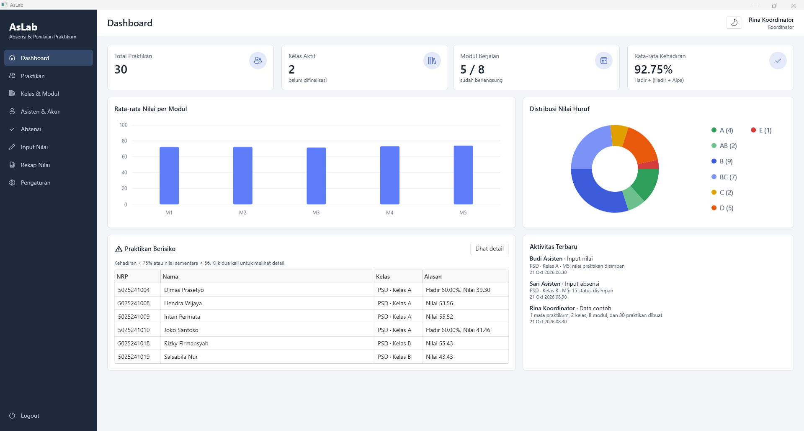 |
| 4 | Dashboard tema gelap | Tema gelap/terang (FR-17) | 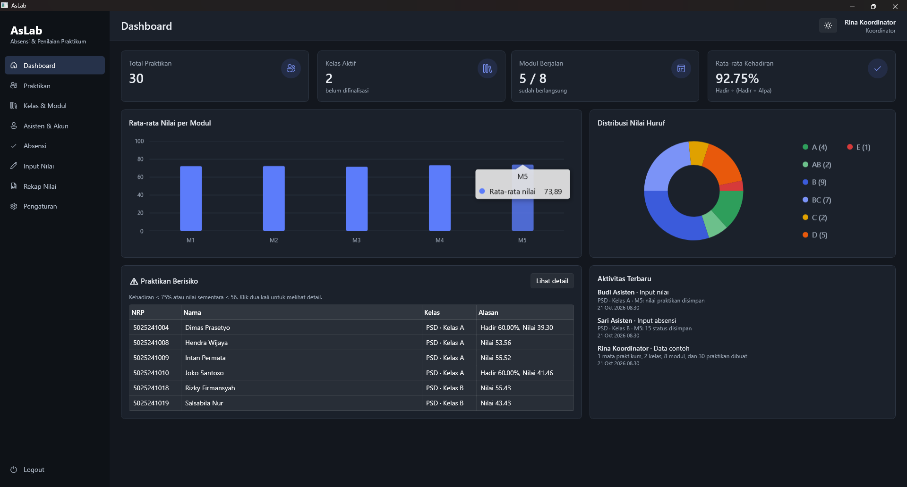 |
| 5 | Data Praktikan | Tabel, pencarian, filter, paging, status risiko, import CSV (FR-03, FR-09, FR-12) | 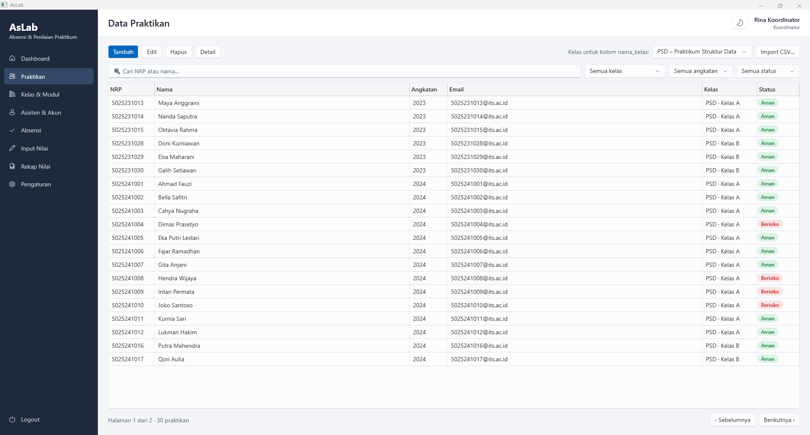 |
| 6 | Validasi form praktikan | NRP harus 10 digit (BR-08, FR-11) | 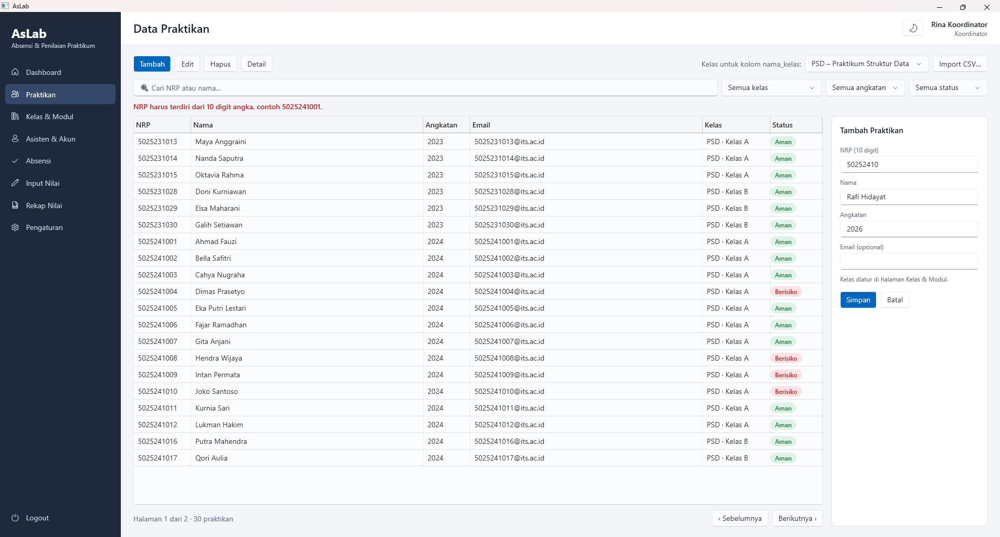 |
| 7 | Kelas & Modul | Master–detail: mata praktikum → kelas → peserta & jadwal modul (FR-04) | 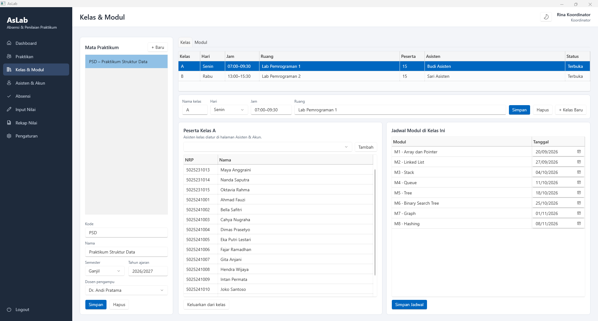 |
| 8 | Asisten & Akun | Kelola akun dan penugasan asisten ke kelas (FR-05) | 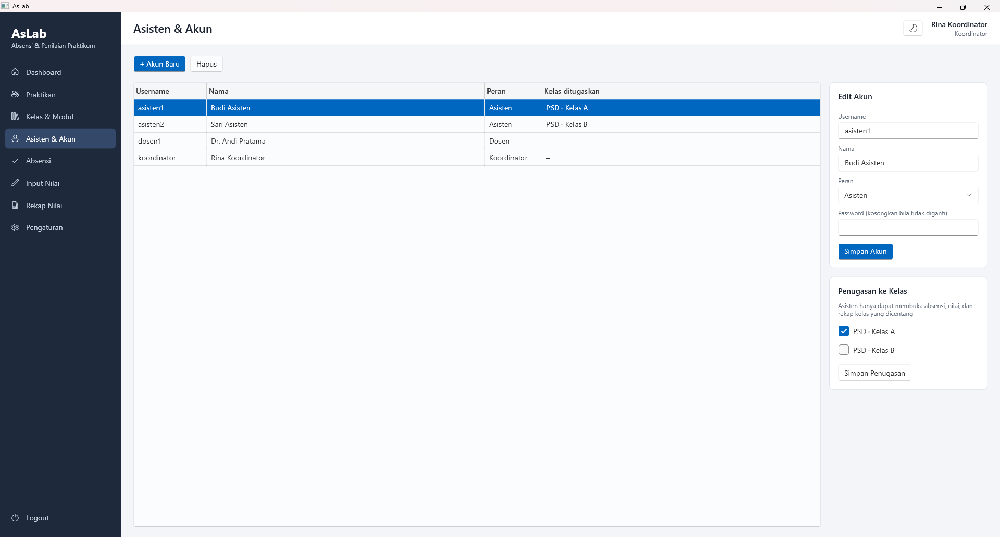 |
| 9 | Absensi | Status Hadir/Izin/Sakit/Alpa dengan badge berwarna (FR-06) | 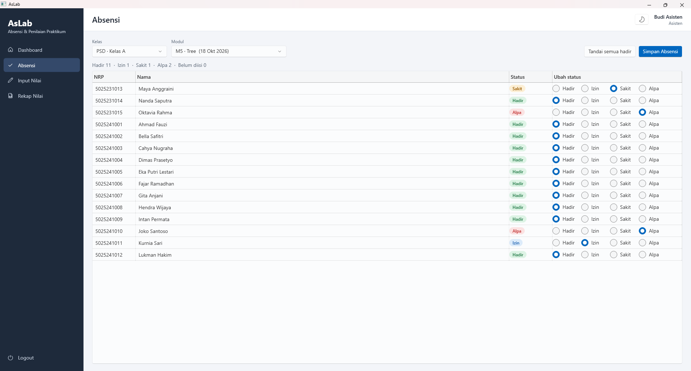 |
| 10 | Input Nilai | Satu kolom per komponen nilai, nilai modul terhitung otomatis (FR-07) | 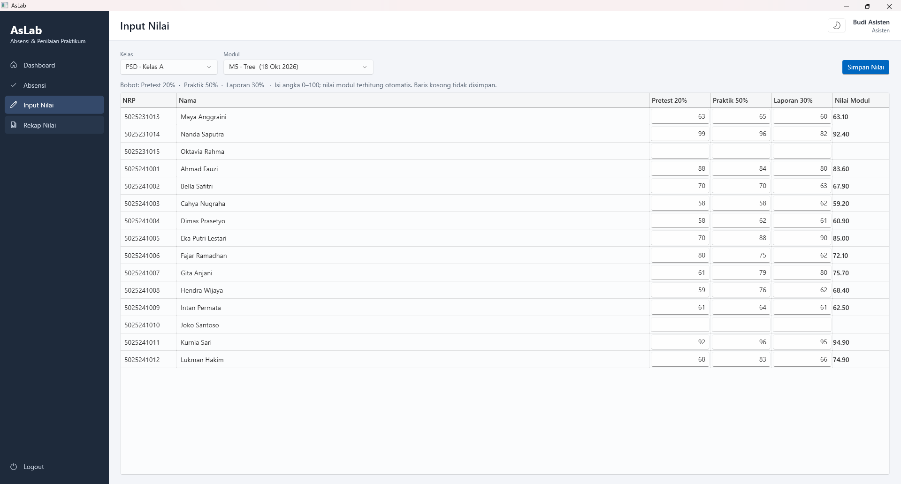 |
| 11 | Validasi nilai | Sel tidak valid ditandai merah, tidak ada yang disimpan (TC-03) | 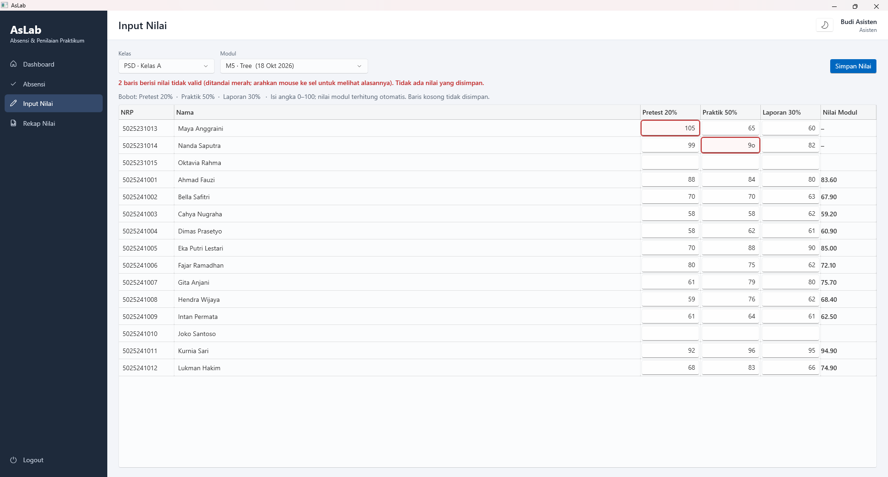 |
| 12 | Rekap Nilai | Nilai per modul, nilai sementara/akhir, huruf, kehadiran, status (FR-08) | 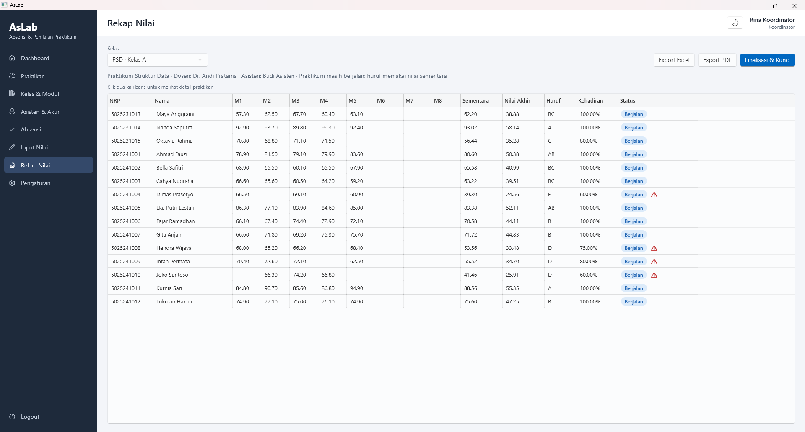 |
| 13 | Rekap terkunci | Kelas difinalisasi di akhir semester: Lulus / Tidak Lulus (FR-14) | 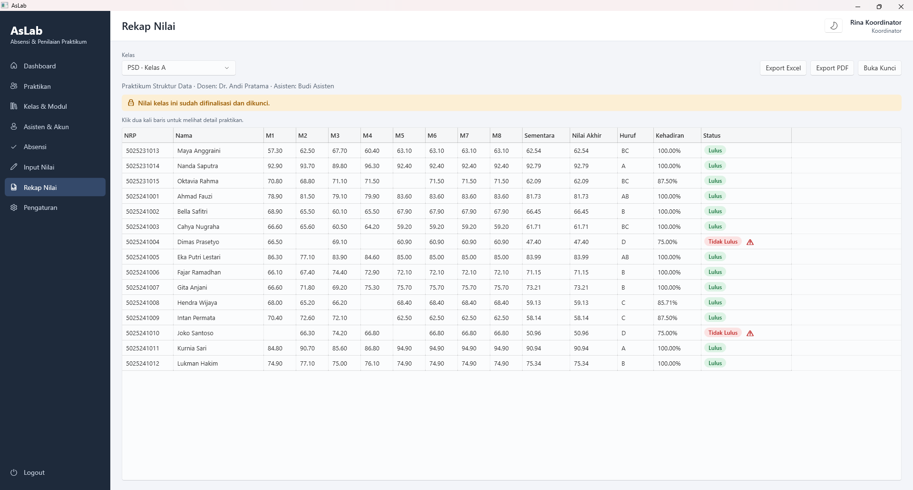 |
| 14 | Detail Praktikan | Profil, grafik progres, riwayat absensi (FR-16) | 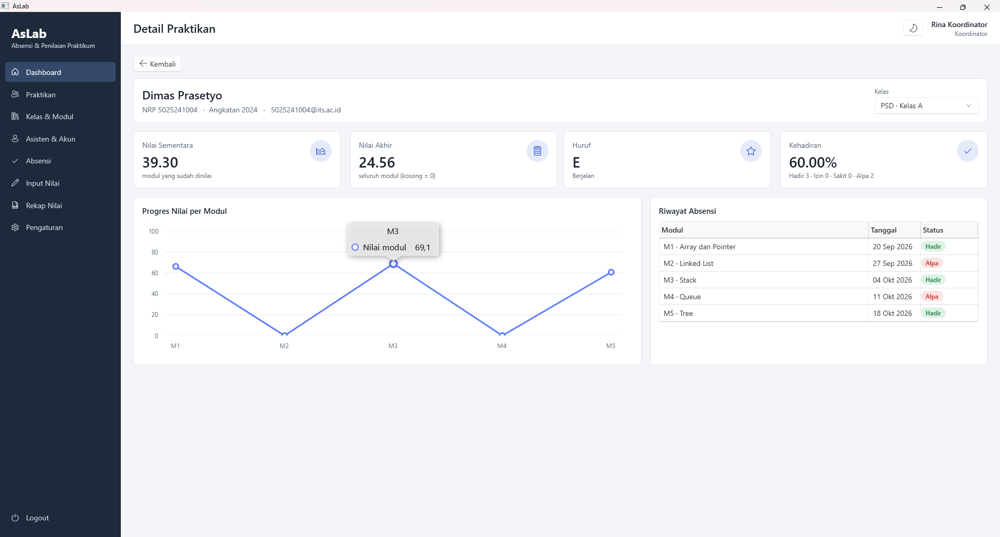 |
| 15 | Pengaturan | Komponen nilai per mata praktikum, tema, backup, log aktivitas (FR-15, FR-18, FR-19) | 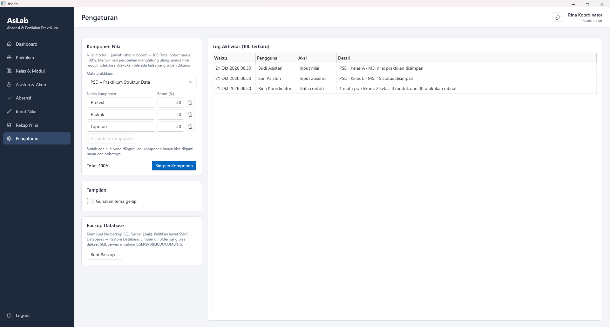 |
| 16 | Dashboard asisten | Menu dan data dibatasi kelas yang ditugaskan (FR-02, BR-11) | 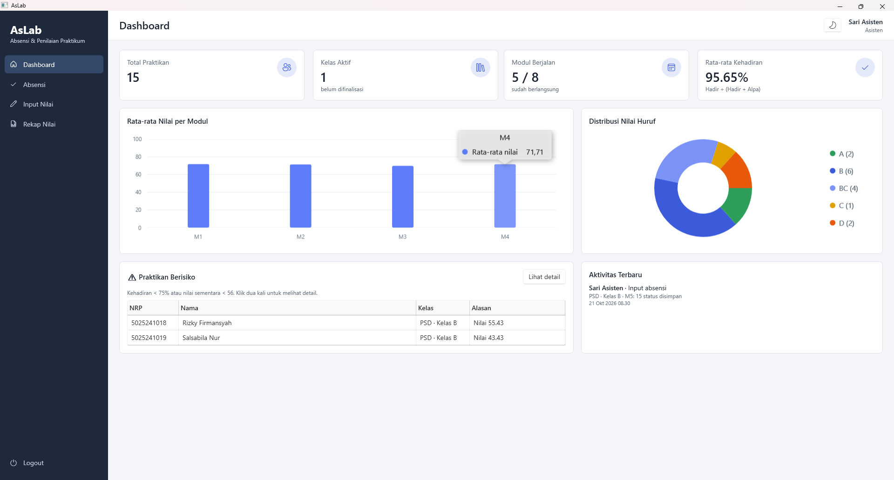 |
| 17 | Rekap dosen | Dosen hanya bisa membaca (BR-11) | 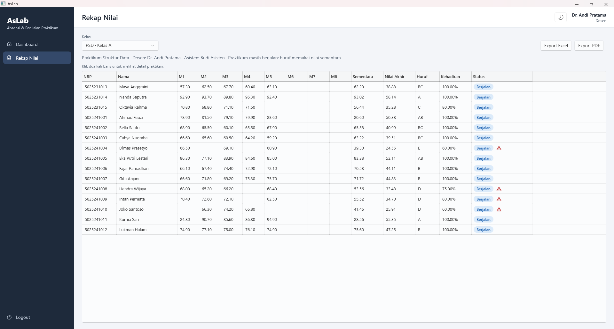 |
| 18 | Hasil export PDF | Rekap kelas dalam PDF (FR-13, TC-08) | 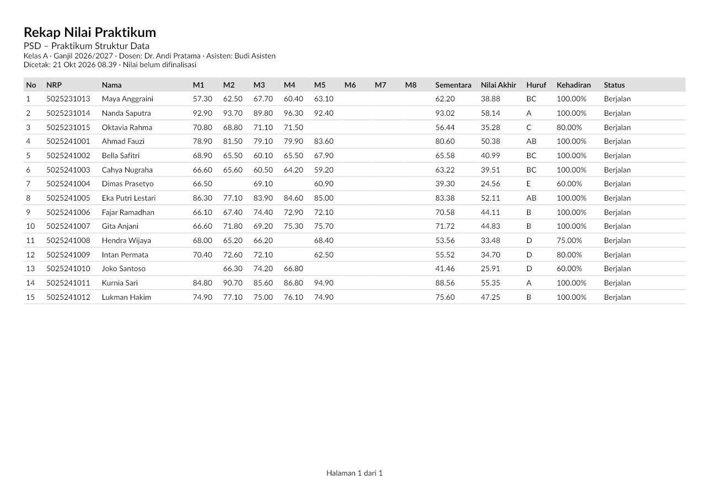 |

---

## 11. Teknologi

| Komponen | Pilihan |
|---|---|
| Bahasa & Framework UI | **C# + WPF** (.NET 10 LTS; .NET 8 berakhir dukungannya November 2026), pola **MVVM** (View XAML + ViewModel), misalnya dengan CommunityToolkit.Mvvm |
| Database | **SQL Server 2022 Express** (instance `localhost\SQLEXPRESS`, Windows Authentication) melalui Entity Framework Core (Microsoft.EntityFrameworkCore.SqlServer). Struktur tabel dibuat lewat **EF Core Migrations**; skrip T-SQL lengkap tersedia di `src/data/schema.sql` untuk dijalankan di SSMS. Connection string disimpan di `appsettings.json`. |
| Tools database | SQL Server Management Studio (SSMS) untuk melihat tabel, menjalankan query, dan restore backup |
| Hash Password | BCrypt.Net-Next |
| Grafik | LiveCharts2 (WPF) |
| Export | ClosedXML (Excel), QuestPDF (PDF) |
| Import CSV | CsvHelper |
| Pengujian | xUnit, memakai database SQL Server terpisah (`AsLab_Uji`) |
| Version Control | Git + GitHub |

### 11.1 Versi Pustaka yang Dipakai

| Pustaka | Versi |
|---|---|
| .NET SDK / Target | 10.0 (`net10.0-windows`) |
| Microsoft.EntityFrameworkCore.SqlServer + Design, dotnet-ef | 10.0.13 |
| CommunityToolkit.Mvvm | 8.4.2 |
| LiveChartsCore.SkiaSharpView.WPF | 2.0.5 |
| ClosedXML | 0.105.1 |
| QuestPDF | 2026.9.1 (lisensi Community) |
| CsvHelper | 33.1.0 |
| BCrypt.Net-Next | 4.2.0 |

### 11.2 Arsitektur

Alur kode selalu **View (XAML) → ViewModel → Service → Entity Framework Core → SQL Server**.
Aturan bisnis dan pengecekan hak akses hanya ada di lapisan Service, tidak di tampilan.

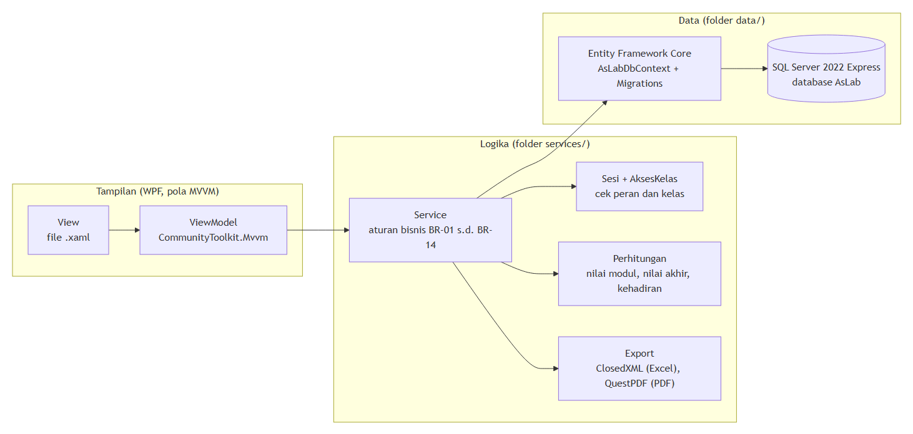

---

## 12. Rencana Pengerjaan

| Minggu | Kegiatan | Output |
|---|---|---|
| 1 | Finalisasi PRD, ERD, dan mockup | PRD, ERD, desain UI |
| 2 | Setup proyek, database, login & role | Aplikasi dapat login sesuai role |
| 3 | CRUD data master & penugasan asisten | Data master dapat dikelola |
| 4 | Modul absensi & input nilai | Absensi dan nilai tersimpan, perhitungan otomatis |
| 5 | Dashboard, rekap, export, fitur tambahan | Dashboard & laporan berfungsi |
| 6 | Pengujian, perbaikan, video demo | Aplikasi final + video |

---

## 13. Pembagian Tugas Tim

Pekerjaan dibagi **per modul (vertikal)**: setiap anggota memegang satu kelompok fitur dari database sampai tampilan, sehingga bisa dikerjakan paralel dengan konflik kode seminimal mungkin. **Export laporan dan video demo tidak dibagi ke satu orang**, melainkan dikerjakan bersama oleh seluruh anggota (lihat Bagian 13.3).

### 13.1 Ringkasan Peran

| | Anggota 1 — Fondasi & Data Master | Anggota 2 — Absensi & Penilaian | Anggota 3 — UI & Dashboard |
|---|---|---|---|
| **Fokus** | Database, autentikasi, pengelolaan data master | Logika inti praktikum: absensi, perhitungan nilai, rekap | Kerangka UI, komponen bersama, dashboard |
| **Fitur (FR)** | FR-01, FR-02, FR-03, FR-04, FR-05, FR-09, FR-11 (validasi data master), FR-12, FR-15 | FR-06, FR-07, FR-08, FR-11 (validasi nilai), FR-14 | FR-10, FR-16, FR-17, FR-18, FR-19 (tampilan; validasi & hitung ulang dari Anggota 2) |
| **Aturan Bisnis** | BR-08, BR-14; **membuat** fungsi akses kelas untuk BR-09 & BR-11 | BR-01 – BR-07, BR-10, BR-12, BR-13; **menerapkan** BR-09 & BR-11 di Absensi, Input Nilai, Rekap | **Menerapkan** BR-11 di Dashboard & Detail Praktikan; memakai hasil hitung Anggota 2 |
| **Halaman** | Login, Data Praktikan, Kelas & Modul, Asisten & Akun | Absensi, Input Nilai, Rekap Nilai | Shell/sidebar, Dashboard, Detail Praktikan, Pengaturan |
| **Dokumen** | PRD & README (penanggung jawab) | Skenario pengujian & data demo | Mockup UI |

### 13.2 Jadwal per Anggota

| Minggu | Anggota 1 | Anggota 2 | Anggota 3 | Bersama |
|---|---|---|---|---|
| **1** — Perancangan | Finalisasi ERD, buat skrip SQL skema, **buat seed data contoh** | Rumuskan aturan bisnis & contoh hitungan, tulis skenario uji | Mockup semua halaman, tentukan warna/font/komponen | Sepakati skema DB & kontrak integrasi (Bagian 13.4) |
| **2** — Fondasi | Koneksi DB, login, hash password, session pengguna, menu per role | Repository absensi & nilai, service perhitungan nilai + uji hitung (TC-04, TC-06) | Setup proyek, main window, sidebar & navigasi, tema terang/gelap, komponen bersama (kartu statistik, tabel, dialog konfirmasi) | — |
| **3** — Fitur inti I | CRUD praktikan, mata praktikum, kelas, modul, jadwal modul per kelas; fungsi akses kelas | Halaman Absensi (pilih kelas & modul, status, "Tandai semua hadir") | Query statistik + kartu statistik dashboard + grafik (pakai seed data) | — |
| **4** — Fitur inti II | CRUD akun & penugasan asisten, pencarian & filter | Halaman Input Nilai (tabel editable, hitung otomatis, validasi), halaman Rekap Nilai | Tabel praktikan berisiko, aktivitas terbaru, halaman Detail Praktikan | Tentukan format laporan Excel/PDF |
| **5** — Fitur tambahan | Import CSV, log aktivitas | Finalisasi, kunci & buka kunci per kelas; terapkan akses kelas di Absensi, Input Nilai, Rekap; hitung ulang saat komponen berubah | Halaman Pengaturan (komponen nilai, backup DB), cakupan data role di Dashboard & Detail, perapian UI | **Export Excel/PDF** |
| **6** — Uji & rilis | Uji silang modul Anggota 2, finalisasi PRD & README | Uji silang modul Anggota 3, siapkan data & naskah demo | Uji silang modul Anggota 1 | **Rekam & edit video demo** |

### 13.3 Tugas Bersama

| Tugas | Cara Pengerjaan |
|---|---|
| **Export Laporan Excel/PDF (FR-13)** | Format laporan (kolom, judul, kop) disepakati bersama di minggu 4. Implementasi dikerjakan bersama di minggu 5, misalnya lewat sesi *pair/mob programming*: data diambil dari service perhitungan (Anggota 2), tombol export dipasang di halaman Rekap, dan tampilan mengikuti komponen UI (Anggota 3). Hasil diuji bersama dengan TC-08. |
| **Video Demo** | Naskah disusun bersama berdasarkan Bagian 15. Setiap anggota merekam dan membawakan segmen modulnya, lalu penyuntingan dan pengecekan akhir dilakukan bersama sebelum dikumpulkan. |

### 13.4 Ketergantungan dan Titik Integrasi

Bagian-bagian berikut dipakai oleh lebih dari satu anggota, sehingga **harus disepakati lebih dulu** agar tidak saling menunggu:

| Kontrak | Pembuat | Dipakai oleh | Tenggat | Isi yang disepakati |
|---|---|---|---|---|
| Skema database + seed data | Anggota 1 | Semua | Akhir minggu 1 | Nama tabel, kolom & constraint sesuai Bagian 9; ±30 praktikan, 2 kelas, 5 modul contoh beserta jadwal per kelas, dengan campuran status Hadir/Izin/Sakit/Alpa |
| Session pengguna | Anggota 1 | Anggota 2, 3 | Minggu 2 | Data pengguna aktif: `id`, `nama`, `role` |
| Service perhitungan | Anggota 2 | Anggota 3 | Minggu 2 | Fungsi: hitung nilai modul, hitung nilai akhir & nilai sementara, hitung % kehadiran, konversi nilai huruf, status kelulusan, cek praktikan berisiko, hitung ulang saat komponen/bobot berubah, validasi komponen (BR-01 – BR-07, BR-12, BR-13) |
| Fungsi akses kelas | Anggota 1 | Anggota 2, 3 | Minggu 3 | `kelasDiizinkan(user)` → daftar `kelas_id` yang boleh diakses sesuai role (BR-09, BR-11) |
| Pencatat log aktivitas | Anggota 1 | Anggota 2 | Minggu 4 | Satu fungsi `catatLog(userId, aksi, detail)` |
| Kerangka UI & komponen bersama | Anggota 3 | Anggota 1, 2 | Minggu 2 | Cara menambah halaman ke sidebar, gaya tabel, form, tombol, dan dialog |

> **Seed data** dari Anggota 1 membuat Anggota 2 dan 3 bisa langsung mengerjakan absensi, nilai, dan dashboard tanpa menunggu fitur CRUD selesai.

### 13.5 Struktur Folder dan Kepemilikan

```
src/
├── data/            (Anggota 1) koneksi DB, skema, seed data, repository data master
├── auth/            (Anggota 1) login, session, hash password, fungsi akses kelas
├── services/
│   ├── master/      (Anggota 1) import CSV, log aktivitas
│   ├── penilaian/   (Anggota 2) perhitungan nilai, absensi, kunci nilai
│   ├── dashboard/   (Anggota 3) query statistik dashboard
│   ├── pengaturan/  (Anggota 3) backup database, simpan komponen nilai
│   └── laporan/     (Bersama)   export Excel/PDF
├── views/
│   ├── master/      (Anggota 1) praktikan, kelas & modul, akun & penugasan
│   ├── akademik/    (Anggota 2) absensi, input nilai, rekap
│   └── dashboard/   (Anggota 3) dashboard, detail praktikan, pengaturan
└── ui/              (Anggota 3) main window, sidebar, tema, komponen bersama
```

Setiap folder `views/` berisi View (XAML) beserta ViewModel-nya (MVVM).

Mengubah folder milik anggota lain dilakukan lewat diskusi atau Pull Request yang di-review pemiliknya. Perubahan pada folder `laporan/` (bersama) di-review minimal oleh satu anggota lain.

### 13.6 Aturan Kerja Tim

- **Repositori:** satu repo GitHub; branch `main` harus selalu bisa dijalankan.
- **Branch:** satu fitur satu branch, contoh `feature/input-nilai`, `feature/dashboard-grafik`.
- **Pull Request:** setiap merge ke `main` lewat PR dan di-review minimal 1 anggota lain.
- **Commit:** pesan jelas, contoh `feat: hitung nilai modul otomatis`, `fix: validasi NRP 10 digit`.
- **Sinkronisasi:** rapat singkat 2× seminggu (±15 menit): apa yang selesai, apa berikutnya, apa yang menghambat.
- **Pelacakan:** checklist di GitHub Projects/Issues mengikuti Bagian 13.7.
- **Definition of Done:** fitur berjalan tanpa error, lolos skenario uji terkait (Bagian 14), sudah di-merge ke `main`, dan sudah dicoba anggota lain.

### 13.7 Checklist Progres

Status per 21 Oktober 2026 (tercentang = sudah ada di aplikasi dan lolos tes).

**Anggota 1 — Fondasi & Data Master**
- [x] Skrip SQL skema + seed data
- [x] Login, hash password, session, menu per role
- [x] CRUD praktikan (dengan validasi NRP)
- [x] CRUD mata praktikum, kelas, modul, jadwal modul per kelas
- [x] CRUD akun & penugasan asisten
- [x] Fungsi akses kelas (BR-09, BR-11)
- [x] Pencarian & filter
- [x] Import CSV
- [x] Log aktivitas (setiap perubahan nilai tercatat)
- [x] PRD & README final

**Anggota 2 — Absensi & Penilaian**
- [x] Service perhitungan nilai & kehadiran + uji hitung
- [x] Halaman Absensi
- [x] Halaman Input Nilai + validasi 0–100
- [x] Halaman Rekap Nilai (nilai akhir, huruf, status)
- [x] Terapkan akses kelas di Absensi, Input Nilai, Rekap
- [x] Finalisasi, kunci & buka kunci per kelas
- [x] Hitung ulang nilai modul saat komponen/bobot berubah
- [x] Data demo (data contoh otomatis saat database pertama dibuat)
- [ ] Naskah demo

**Anggota 3 — UI & Dashboard**
- [x] Mockup semua halaman (diganti screenshot hasil implementasi, Bagian 10.2)
- [x] Main window, sidebar, tema terang/gelap
- [x] Komponen bersama (kartu statistik, tabel, dialog)
- [x] Dashboard: kartu statistik + 2 grafik
- [x] Praktikan berisiko & aktivitas terbaru
- [x] Halaman Detail Praktikan
- [x] Cakupan data per role di Dashboard & Detail Praktikan
- [x] Halaman Pengaturan (komponen nilai, backup database)

**Bersama — Seluruh Anggota**
- [x] Kesepakatan skema DB & kontrak integrasi
- [x] Format laporan Excel/PDF disepakati
- [x] Export Excel/PDF berfungsi & lolos TC-08
- [ ] Naskah video demo
- [ ] Rekaman segmen masing-masing anggota
- [ ] Penyuntingan & pengecekan akhir video
- [ ] Posting laporan ke Blogspot (bahan siap di `docs/blogspot/`)

---

## 14. Skenario Pengujian

| ID | Skenario | Hasil yang Diharapkan |
|---|---|---|
| TC-01 | Login dengan password salah | Muncul pesan error, tidak masuk aplikasi |
| TC-02 | Tambah praktikan dengan NRP yang sudah ada | Ditolak dengan pesan "NRP sudah terdaftar" |
| TC-03 | Input nilai 105 | Sel ditandai merah, data tidak tersimpan |
| TC-04 | Input pretest 80, praktik 90, laporan 70 (komponen bawaan 20/50/30) | Nilai modul = 82.00 |
| TC-05 | Asisten membuka kelas yang tidak ditugaskan; dosen membuka mata praktikum yang tidak diampunya | Kelas/praktikum tidak muncul di menu, dashboard, maupun rekap; akses ditolak |
| TC-06 | Praktikan 5 Hadir dan 3 Alpa dari 8 modul | Kehadiran 62.50%, status "Tidak Memenuhi Syarat", muncul di daftar berisiko |
| TC-07 | Asisten mengubah nilai atau absensi di kelas yang sudah dikunci | Tabel read-only, perubahan ditolak |
| TC-08 | Export rekap kelas | File Excel/PDF berisi data sesuai tampilan rekap |
| TC-09 | Praktikan 6 Hadir, 1 Izin, 1 Alpa dari 8 modul | Kehadiran = 6 ÷ 7 = 85.71%, tidak berisiko karena kehadiran |
| TC-10 | Nilai akhir 85.99 dan 86.00 | Masing-masing dikonversi menjadi AB dan A |
| TC-11 | Praktikan tidak memiliki nilai pada 1 dari 5 modul; 4 modul lainnya bernilai 80 | Nilai akhir = (80 × 4 + 0) ÷ 5 = 64.00 (BC) |
| TC-12 | Koordinator mengubah bobot komponen menjadi 30/40/30 | Nilai modul TC-04 dihitung ulang menjadi 81.00 dan tercatat di log; perubahan ditolak bila ada kelas yang sudah dikunci |
| TC-13 | Import CSV berisi 1 baris NRP 9 digit dan 1 baris NRP duplikat | Baris valid terimpor; ringkasan menampilkan 2 baris gagal beserta nomor baris dan alasannya |
| TC-14 | Koordinator mengganti komponen mata praktikum baru menjadi Kuis 10, Tugas 20, Demo 30, Laporan 40, lalu asisten mengisi 100/80/60/90 | Input Nilai menampilkan 4 kolom; nilai modul = 80.00. Menambah atau menghapus komponen setelah ada nilai ditolak |

**Hasil:** TC-01 sampai TC-14 diotomatisasi di `tests/AsLab.Tests` (xUnit) bersama uji aturan bisnis BR-01 sampai BR-14.
Per 21 Oktober 2026, **62 tes lolos** dengan perintah `dotnet test` pada SQL Server 2022 Express (database uji `AsLab_Uji`).
Tampilan setiap skenario juga diperiksa lewat screenshot di Bagian 10.2, misalnya TC-01 (gambar 2) dan TC-03 (gambar 11).

---

## 15. Alur Video Demo (5–7 menit)

Video dikerjakan bersama: naskah dan penyuntingan dilakukan oleh seluruh anggota, sedangkan setiap anggota membawakan segmen modul yang dikerjakannya.

| No | Segmen | Isi | Pembawa |
|---|---|---|---|
| 1 | Pembukaan | Perkenalan tim, masalah yang diselesaikan | Anggota 1 |
| 2 | Koordinator | Login → import praktikan dari CSV → buat kelas & modul → tugaskan asisten | Anggota 1 |
| 3 | Asisten | Login → isi absensi modul → input nilai (tunjukkan hitung otomatis & validasi salah input) | Anggota 2 |
| 4 | Uji akses | Asisten mencoba membuka kelas lain → ditolak | Anggota 2 |
| 5 | Dashboard | Grafik berubah, praktikan berisiko muncul, ganti tema gelap/terang | Anggota 3 |
| 6 | Finalisasi | Koordinator mengunci nilai → export rekap ke Excel/PDF | Anggota 2 |
| 7 | Dosen | Login read-only, melihat grafik per modul | Anggota 3 |
| 8 | Penutup | Ringkasan fitur dan pengembangan selanjutnya | Anggota 3 |

---

## 16. Status Implementasi

Per 21 Oktober 2026 seluruh kebutuhan fungsional sudah diimplementasi di repositori
[mouisbeton/AsLab](https://github.com/mouisbeton/AsLab).

| ID | Fitur | Status | Lokasi utama di kode |
|---|---|---|---|
| FR-01 | Login & Logout | Selesai | `src/auth/LoginWindow.xaml`, `AuthService.cs` |
| FR-02 | Role-Based Access | Selesai | `src/ui/MainViewModel.cs` (menu), `src/auth/AksesKelas.cs` (data) |
| FR-03 | CRUD Praktikan | Selesai | `src/views/master/Praktikan*`, `services/master/PraktikanService.cs` |
| FR-04 | CRUD Mata Praktikum, Kelas, Modul | Selesai | `src/views/master/KelasModul*`, `PraktikumService.cs`, `KelasService.cs` |
| FR-05 | Kelola Akun & Penugasan Asisten | Selesai | `src/views/master/Akun*`, `AkunService.cs` |
| FR-06 | Input Absensi | Selesai | `src/views/akademik/Absensi*`, `services/penilaian/AbsensiService.cs` |
| FR-07 | Input Nilai | Selesai | `src/views/akademik/InputNilai*`, `NilaiService.cs` |
| FR-08 | Rekap Nilai Akhir | Selesai | `src/views/akademik/Rekap*`, `RekapService.cs` |
| FR-09 | Pencarian & Filter | Selesai | `PraktikanViewModel.cs` |
| FR-10 | Dashboard | Selesai | `src/views/dashboard/Dashboard*`, `DashboardService.cs` |
| FR-11 | Validasi Input | Selesai | `Perhitungan.cs`, setiap service (`AturanException`) |
| FR-12 | Import CSV | Selesai | `ImportCsvService.cs`, contoh file `docs/contoh-import.csv` |
| FR-13 | Export Excel/PDF | Selesai | `services/laporan/ExportService.cs`, contoh hasil `docs/contoh-export/` |
| FR-14 | Finalisasi, Kunci & Buka Kunci | Selesai | `KunciService.cs` |
| FR-15 | Log Aktivitas | Selesai | `LogService.cs` (tampil di Dashboard dan Pengaturan) |
| FR-16 | Detail Praktikan | Selesai | `src/views/dashboard/DetailPraktikan*` |
| FR-17 | Tema Gelap/Terang | Selesai | `src/ui/Tema/` |
| FR-18 | Backup Database | Selesai | `PengaturanService.Backup` (file `.bak`) |
| FR-19 | Pengaturan Komponen Nilai | Selesai | `PengaturanService.SimpanKomponen`, halaman Pengaturan |

**Catatan dan keterbatasan yang diketahui:**
- Pengujian otomatis mencakup seluruh service dan logika halaman Input Nilai. Alur klik pada antarmuka (dialog simpan/buka file, konfirmasi) diperiksa lewat screenshot dan perlu dicoba manual sekali sebelum rekaman video demo.
- Tabel Rekap Nilai dapat digeser horizontal bila jumlah modul banyak; jendela utama terbuka maximized.
- File backup `.bak` ditulis oleh service SQL Server, sehingga harus disimpan di folder yang bisa diakses service tersebut (misalnya `C:\Users\Public\Documents`).
- Nama dan NRP anggota tim pada tabel di awal dokumen masih perlu diisi.
